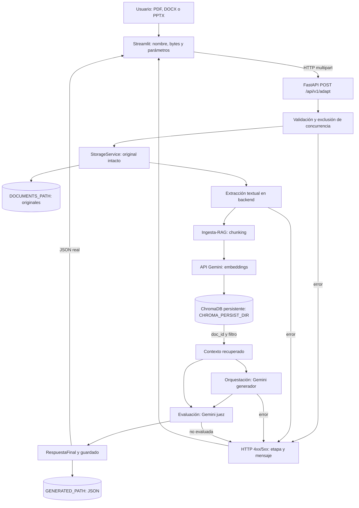

# Informe de integración local de NuevaMente

Fecha: **19 de octubre de 2026**, zona de referencia America/Mexico_City. Alcance: integración local Windows, estado Git y evidencias disponibles en esta sesión. Este informe no acredita un despliegue en OCI.

## 1. Resumen ejecutivo

Se conectó Streamlit → FastAPI → extracción → Ingesta-RAG/ChromaDB → generación Gemini → evaluación Gemini → almacenamiento local. El endpoint dejó de importar mocks y el frontend dejó de fabricar respuestas exitosas ante errores. Los modelos se consumen mediante APIs externas.

El código base coordinaba cuatro mocks, enviaba texto en JSON y no implementaba almacenamiento local del original. Los módulos reales de RAG, generación y evaluación **ya existían**: la integración los conectó y adaptó sus imports, configuración y contratos.

La sesión anterior registró **68 casos automáticos aprobados**, verificaciones reales de PDF, DOCX y PPTX y una comprobación Streamlit/HTTP real. En esta tarea documental se contrastaron esas salidas con el código de pruebas y cuatro resultados locales todavía presentes. No se ejecutaron nuevamente pruebas ni APIs. Los artefactos corroboran persistencia, pero no demuestran por sí solos su procedencia de Gemini.

El almacenamiento activo es local. El contrato opcional `AlmacenamientoOCI` no implica una subida a Object Storage. La carpeta histórica `oci-storage/` vacía no constituye por sí sola un defecto: la responsabilidad está en backend.

## 2. Entorno de desarrollo

Versiones comprobadas nuevamente con los ejecutables de los entornos e `importlib.metadata`, sin iniciar la aplicación:

| Componente | Versión verificada |
|---|---|
| SO informado por Python | Windows 10, compilación 10.0.19045 |
| Python backend y frontend | 3.12.10 en ambos |
| FastAPI / Uvicorn | 0.149.0 / 0.54.0 |
| Streamlit / requests | 1.66.0 / 2.34.2 |
| Pydantic / pydantic-settings | 2.13.5 / 2.16.0 |
| ChromaDB / langchain-chroma | 1.5.9 / 1.1.0 |
| langchain-core / langchain-google-genai | 1.6.6 / 4.4.0 |
| google-genai | 2.31.0 |
| pypdf / python-docx / python-pptx | 6.19.0 / 1.2.0 / 1.0.2 |
| python-multipart / python-dotenv | 0.0.32 / 1.2.4 |
| pytest / httpx, backend | 9.1.1 / 0.28.1 |

Entornos: `.venv-frontend` para presentación/HTTP y `.venv-backend` para API, extracción, Chroma, Gemini y pruebas backend. Los manifiestos expresan dependencias solicitadas; no son un lock completo del entorno instalado. La integración anterior instaló dependencias faltantes; **esta revisión documental no instaló ninguna**.

## 3. Hallazgos iniciales

Problemas confirmados al comparar HEAD con las fuentes actuales:

| Hallazgo | Evidencia original y contraste actual |
|---|---|
| Cuatro mocks activos | HEAD de `backend/services/adaptation_service.py` importaba `mocks.rag_mock`, `orchestration_mock`, `evaluation_mock` y `storage_mock`. Ahora usa servicios reales: [backend/services/adaptation_service.py:27](backend/services/adaptation_service.py#L27). |
| Sin escritura del original | `StorageService.guardar()` contenía `...`. Ahora escribe bytes: [backend/services/storage_service.py:11](backend/services/storage_service.py#L11). |
| Binarios sin extracción | El callback intentaba UTF-8 y sustituía los fallos por una descripción del archivo. Ahora conserva bytes: [interfaz/pages/seccion1_carga.py:14](interfaz/pages/seccion1_carga.py#L14). |
| Fallos ocultos mediante simulación | `generar()` invocaba `_crear_resultado_simulado()` si la API fallaba. El simulador fue eliminado: [interfaz/pages/seccion2_parametros.py:35](interfaz/pages/seccion2_parametros.py#L35). |
| Imports ambiguos | Backend y RAG importaban `services.*`; RAG también usaba `utils`, `models`, `contratos` como módulos superiores. Se corrigió mediante alias e imports relativos: [shared/module_loader.py:10](shared/module_loader.py#L10). |
| Contratos incompatibles al conectar implementaciones | El evaluador real requiere contenido, contexto, perfil y formato; su mock recibía solo contenido/contexto. Las etiquetas largas del frontend tampoco coincidían con el resolver de generación: [backend/services/evaluation_service.py:5](backend/services/evaluation_service.py#L5) y [backend/services/adaptation_service.py:19](backend/services/adaptation_service.py#L19). |
| URL y espera fijas | La interfaz usaba localhost y cinco segundos. Ahora son configurables: [interfaz/client_config.py:7](interfaz/client_config.py#L7). |
| Recurso importado ausente | HEAD de `interfaz/app.py` incluía `import assets`; se eliminó. El logo sigue siendo opcional, sujeto a comprobación de existencia. |

Problemas observados en ejecución durante la sesión anterior, cuya evidencia no procede únicamente del diff:

- La consulta inicial de Gemini produjo `ConnectError`. El diagnóstico identificó categorías `certificate` y `ssl`; la consulta funcionó después de usar los certificados del sistema. No se conservó un diagnóstico independiente de la cadena concreta ni de su emisor. No se atribuye la causa a un proxy o antivirus específico.
- Una credencial configurada fue rechazada con `API_KEY_INVALID`; se añadió rotación para ese caso. La rotación ante cuota y la alternativa de modelos ya existían en HEAD.
- El entorno suministró `DEBUG=release`, incompatible con el booleano original de Settings. Se añadió compatibilidad y preferencia por `APP_DEBUG`.
- El modelo principal informó saturación; el flujo pudo utilizar el respaldo configurado.

Hipótesis descartadas o no demostradas: los modelos no se demostraron inexistentes; la consulta histórica de catálogo los indicó disponibles. Las colisiones de imports se verifican como riesgo estructural, sin afirmar una traza previa de cada colisión. No hay evidencia de que el hardware de OCI explicara los fallos locales: no se ejecutó allí. Un health exitoso tampoco acreditaba la integración de Gemini o almacenamiento.

## 4. Correcciones implementadas

Las referencias se resuelven contra el código actualizado leído durante esta revisión. No son líneas estimadas de la versión anterior.

| Corrección y componente | Problema y comportamiento anterior → solución → comportamiento actual | Archivos, funciones y líneas actuales |
|---|---|---|
| Carga Streamlit | Decodificación de binarios → conservar nombre/bytes y limpiar resultado previo → extracción delegada al backend. | [interfaz/pages/seccion1_carga.py:14](interfaz/pages/seccion1_carga.py#L14) |
| Cliente HTTP | JSON, localhost y cinco segundos → `data=...`, `files=...`, URL y timeout configurables → archivo original más cuatro campos de formulario. | [interfaz/pages/seccion2_parametros.py:35](interfaz/pages/seccion2_parametros.py#L35); [interfaz/client_config.py:9](interfaz/client_config.py#L9) |
| Errores de interfaz | Simulador y capturas que ocultaban errores → eliminación de resultados ficticios y presentación del fallo → permanece en parámetros si la API no devuelve éxito. | [interfaz/pages/seccion2_parametros.py:85](interfaz/pages/seccion2_parametros.py#L85); [interfaz/app.py:73](interfaz/app.py#L73) |
| Endpoint FastAPI | Modelo JSON → `UploadFile`, `File` y `Form`, cerrado en `finally` → multipart real. Es un cambio incompatible para clientes JSON antiguos. | [backend/api/adaptation.py:13](backend/api/adaptation.py#L13) |
| Coordinación real | Cuatro mocks → servicios reales, formatos canónicos, `doc_id` y metadatos → contexto vacío y evaluación no disponible impiden devolver éxito. | [backend/services/adaptation_service.py:27](backend/services/adaptation_service.py#L27) |
| Imports y contratos | Namespaces ambiguos y contrato RAG duplicado → backend cualificado, alias `ingesta_rag`/`orquestacion_agentes`, imports relativos y `shared.contratos` → módulos coexistentes sin renombrar directorios. La copia histórica `ingesta-rag/contratos.py` permanece sin usarse en el flujo conectado. | [backend/app.py:12](backend/app.py#L12); [shared/module_loader.py:10](shared/module_loader.py#L10); [ingesta-rag/services/indexing_service.py:7](ingesta-rag/services/indexing_service.py#L7); [ingesta-rag/models/vector_db.py:12](ingesta-rag/models/vector_db.py#L12) |
| Extracción | Ausente del pipeline → pypdf para PDF, párrafos/tablas DOCX, texto/tablas/grupos PPTX y UTF-8 TXT/MD → texto extraído o error 422. | [backend/services/extraction_service.py:25](backend/services/extraction_service.py#L25); [backend/services/extraction_service.py:13](backend/services/extraction_service.py#L13) |
| Original | Método vacío → nombre saneado y prefijo UUID, apertura `xb` → bytes/extensión conservados, sin sobrescritura por nombre repetido. | [backend/services/storage_service.py:11](backend/services/storage_service.py#L11) |
| Resultado JSON | Mock de subida → serialización completa, temporal y `replace()` → guardado antes de devolver éxito; sin transacción conjunta con Chroma. | [backend/services/storage_service.py:25](backend/services/storage_service.py#L25); [shared/contratos.py:115](shared/contratos.py#L115) |
| Presentación de persistencia | Se mostraba OCI incluso con datos de demo → almacenamiento local separado y OCI opcional → UI muestra archivos locales; reiniciar limpia estado de archivo/tarjetas/quiz. | [interfaz/pages/seccion3_resultados.py:20](interfaz/pages/seccion3_resultados.py#L20); [interfaz/pages/seccion3_resultados.py:77](interfaz/pages/seccion3_resultados.py#L77); [shared/contratos.py:121](shared/contratos.py#L121) |
| Configuración | `.env` y rutas dependían del contexto → raíz por `__file__`, dotenv explícito y `project_path()` → configuración central y rutas persistentes estables. El entorno exportado tiene prioridad. | [shared/config.py:6](shared/config.py#L6); [shared/config.py:10](shared/config.py#L10); [backend/core/config.py:45](backend/core/config.py#L45); [ingesta-rag/utils/config.py:50](ingesta-rag/utils/config.py#L50) |
| Debug/límites | DEBUG global incompatible y falta de límites de carga → alias APP_DEBUG, soporte `release`, TOP_K y tamaño validados → configuración controlada al iniciar. | [backend/core/config.py:10](backend/core/config.py#L10); [backend/core/config.py:40](backend/core/config.py#L40); [backend/core/config.py:34](backend/core/config.py#L34) |
| TLS | Fallo de confianza observado → contexto seguro del sistema y `client_args` comunes → validación conservada, sin `verify=False`. | [shared/gemini_transport.py:7](shared/gemini_transport.py#L7); [shared/gemini_transport.py:11](shared/gemini_transport.py#L11); [orquestacion-agentes/main.py:129](orquestacion-agentes/main.py#L129); [evaluacion/services/evaluador.py:68](evaluacion/services/evaluador.py#L68) |
| Credenciales | Clave inválida abortaba → clasificación de `API_KEY_INVALID`, `API_KEY_EXPIRED`, `UNAUTHENTICATED` → intenta otra clave, sin alterar `.env`. | [orquestacion-agentes/main.py:151](orquestacion-agentes/main.py#L151); [orquestacion-agentes/main.py:156](orquestacion-agentes/main.py#L156); [evaluacion/services/evaluador.py:90](evaluacion/services/evaluador.py#L90) |
| Embeddings/logs | Reintentos por cuota sin límite de intentos por lote y fragmentos de claves en logs → contador configurable y supresión de esos fragmentos → error explícito al agotar intentos. No hay plazo global máximo por documento. | [ingesta-rag/services/embedding_service.py:48](ingesta-rag/services/embedding_service.py#L48); [ingesta-rag/utils/config.py:34](ingesta-rag/utils/config.py#L34); [ingesta-rag/utils/key_manager.py:53](ingesta-rag/utils/key_manager.py#L53) |
| Etapas y concurrencia | Sin traducción específica de integración → PipelineError, JSONResponse y Lock no bloqueante → error por etapa y HTTP 429 si el proceso está ocupado. | [backend/core/exceptions.py:25](backend/core/exceptions.py#L25); [backend/app.py:25](backend/app.py#L25); [backend/services/adaptation_service.py:40](backend/services/adaptation_service.py#L40) |
| Dependencias y verificación | Manifiestos parciales y ejemplos antiguos → parsers/multipart/dotenv, dependencias RAG/dev, tests, guía y scripts → ejecución documentada. El pin de Streamlit y requests son preexistentes. | [backend/requirements.txt:6](backend/requirements.txt#L6); [backend/requirements-dev.txt:2](backend/requirements-dev.txt#L2); [interfaz/requirements.txt:6](interfaz/requirements.txt#L6); [scripts/verify_real_pipeline.py:64](scripts/verify_real_pipeline.py#L64) |

Fragmentos breves contrastados con las fuentes:

```python
# shared/config.py
ENV_FILE = PROJECT_ROOT / ".env"
load_dotenv(ENV_FILE, override=False)
```

```python
# shared/gemini_transport.py::_ssl_context
return ssl.create_default_context()
```

Chroma ya usaba `persist_directory` y filtrado por documento en HEAD. La integración conectó ese código y estabilizó imports/ruta; no creó desde cero su persistencia: [ingesta-rag/models/vector_db.py:18](ingesta-rag/models/vector_db.py#L18) y [ingesta-rag/models/vector_db.py:59](ingesta-rag/models/vector_db.py#L59).

## 5. Inventario de archivos modificados

**45 archivos documentados: 32 rastreados modificados y 13 nuevos sin seguimiento.**

| Ruta | Tipo | Descripción | Módulo |
|---|---|---|---|
| `.env.example` | Nuevo, sin seguimiento | Plantilla central sin credenciales reales. | Raíz/configuración |
| `.gitignore` | Modificado | Excluye originales y resultados locales de Git. | Raíz/configuración |
| `README.md` | Modificado | Enlaza la guía vigente de ejecución real. | Raíz/configuración |
| `backend/README.MD` | Modificado | Advierte que los ejemplos JSON y .env por módulo son anteriores. | backend |
| `backend/api/adaptation.py` | Modificado | Endpoint multipart, respuesta tipada y cierre del archivo. | backend |
| `backend/app.py` | Modificado | Imports cualificados, arranque compatible y manejador de errores. | backend |
| `backend/core/config.py` | Modificado | .env central, límites y compatibilidad APP_DEBUG/DEBUG. | backend |
| `backend/core/exceptions.py` | Modificado | PipelineError con etapa y código HTTP. | backend |
| `backend/requirements-dev.txt` | Nuevo, sin seguimiento | Dependencias de validación offline. | backend |
| `backend/requirements.txt` | Modificado | Multipart, parsers Office y dependencias RAG. | backend |
| `backend/schemas/request.py` | Modificado | Normalización de espacios en el contrato interno. | backend |
| `backend/services/adaptation_service.py` | Modificado | Pipeline real, formatos, concurrencia, errores y metadatos. | backend |
| `backend/services/evaluation_service.py` | Modificado | Adaptador a la firma real de evaluación. | backend |
| `backend/services/extraction_service.py` | Nuevo, sin seguimiento | Extracción PDF/DOCX/PPTX/TXT/MD y límites ZIP. | backend |
| `backend/services/orchestration_service.py` | Modificado | Adaptador al generador real. | backend |
| `backend/services/rag_service.py` | Modificado | Indexación y recuperación reales. | backend |
| `backend/services/storage_service.py` | Modificado | Original intacto y escritura atómica del JSON. | backend |
| `backend/tests/test_pipeline.py` | Nuevo, sin seguimiento | HTTP, archivos, Chroma, errores y contratos sin Gemini externo. | backend |
| `docs/ejecucion-local.md` | Nuevo, sin seguimiento | Guía de configuración, arranque, contratos y límites. | docs |
| `evaluacion/services/evaluador.py` | Modificado | Configuración central, TLS, rotación de credenciales y logs. | evaluacion |
| `evaluacion/tests/test_evaluador.py` | Modificado | Regresión de credencial inválida. | evaluacion |
| `ingesta-rag/models/vector_db.py` | Modificado | Imports y contrato compartido; errores sin detalles externos. | ingesta-rag |
| `ingesta-rag/services/chunker.py` | Modificado | Import relativo de configuración; algoritmo conservado. | ingesta-rag |
| `ingesta-rag/services/embedding_service.py` | Modificado | TLS, imports, reintentos limitados y logs sin claves. | ingesta-rag |
| `ingesta-rag/services/indexing_service.py` | Modificado | Imports relativos del paquete RAG. | ingesta-rag |
| `ingesta-rag/services/ingestion.py` | Modificado | Imports relativos y contrato compartido. | ingesta-rag |
| `ingesta-rag/services/retrieving_service.py` | Modificado | Imports, contrato compartido y supresión de texto en logs. | ingesta-rag |
| `ingesta-rag/utils/config.py` | Modificado | Configuración central, ruta Chroma y límite de intentos. | ingesta-rag |
| `ingesta-rag/utils/key_manager.py` | Modificado | Elimina fragmentos de claves de logs. | ingesta-rag |
| `interfaz/app.py` | Modificado | Elimina import assets ausente y capturas que ocultaban errores. | interfaz |
| `interfaz/client_config.py` | Nuevo, sin seguimiento | URL backend, prefijo y espera configurables. | interfaz |
| `interfaz/pages/seccion1_carga.py` | Modificado | Conserva bytes y delega extracción al backend. | interfaz |
| `interfaz/pages/seccion2_parametros.py` | Modificado | Multipart configurable, errores reales y eliminación del simulador. | interfaz |
| `interfaz/pages/seccion3_resultados.py` | Modificado | Almacenamiento local, observaciones y limpieza de estado. | interfaz |
| `interfaz/requirements.txt` | Modificado (mixto) | Mixto: Streamlit/requests preexistentes; dotenv de integración. | interfaz |
| `interfaz/tests/test_client.py` | Nuevo, sin seguimiento | AppTest de multipart, errores y presentación con HTTP sustituido. | interfaz |
| `orquestacion-agentes/main.py` | Modificado | Configuración central, TLS y rotación ante claves inválidas. | orquestacion-agentes |
| `orquestacion-agentes/tests/test_validaciones.py` | Modificado | Regresión de rotación ante clave inválida. | orquestacion-agentes |
| `scripts/check_gemini_models.py` | Nuevo, sin seguimiento | Diagnóstico manual de acceso a modelos y TLS. | scripts |
| `scripts/verify_real_pipeline.py` | Nuevo, sin seguimiento | Verificación real por formato y modo Streamlit/Uvicorn. | scripts |
| `scripts/verify_streamlit_real.py` | Nuevo, sin seguimiento | AppTest contra HTTP real con estado de carga. | scripts |
| `shared/config.py` | Nuevo, sin seguimiento | Raíz, dotenv central y resolución de rutas. | shared |
| `shared/contratos.py` | Modificado | AlmacenamientoLocal y almacenamiento OCI opcional. | shared |
| `shared/gemini_transport.py` | Nuevo, sin seguimiento | TLS seguro con confianza del sistema y timeout de transporte. | shared |
| `shared/module_loader.py` | Nuevo, sin seguimiento | Alias de paquetes para los directorios con guiones. | shared |

La tabla incluye integración, configuración, pruebas y documentación, excluyendo estos dos entregables. No hay eliminaciones ni cambios staged en la instantánea inicial. `backend/mocks/` permanece en el repositorio, fuera del flujo activo. Sin seguimiento no significa añadido al índice ni incluido en un commit.

## 6. Arquitectura y flujo de procesamiento

Streamlit presenta y carga; FastAPI valida y coordina. Ingesta-RAG divide texto y obtiene embeddings externos. Chroma es embebido, persistente y utiliza metadatos `doc_id`. Orquestación genera Flashcards o Quiz mediante Gemini con salida estructurada. Evaluación consulta un juez Gemini y calcula el score en código. StorageService escribe originales y JSON en disco.



El diagrama resume el camino principal, no cada excepción. **Tres persistencias distintas:** original binario, fragmentos/vectores/metadatos en Chroma y respuesta JSON. Guardar una no garantiza completar las otras. No hay servidor Chroma remoto, cola de trabajos ni grafo de múltiples agentes: existen funciones/servicios de generación y evaluación.

## 7. Configuración

La plantilla segura es `.env.example`. No se copió el contenido real de `.env`. Los ejemplos siguientes son públicos o predeterminados del código, no credenciales locales.

| Variable | Ejemplo seguro y función |
|---|---|
| `GEMINI_API_KEYS` | `<CLAVE_1>,<CLAVE_2>`; pool separado por comas, obligatorio para RAG. Sustituir los marcadores fuera de Git. |
| `GEMINI_API_KEY`, `GOOGLE_API_KEY` | Alternativas opcionales de generación/evaluación; no sustituyen al pool obligatorio de RAG. Evitar marcadores inválidos. |
| `GEMINI_MODEL`, `GEMINI_MODEL_RESPALDO` | `gemini-3.6-flash`, `gemini-3.8-flash`, según plantilla; comprobar acceso/cuota al ejecutar. |
| `MODELO_EMBEDDINGS` | `gemini-embedding-001`; debe ser coherente con el índice existente. |
| `CHUNK_SIZE`, `CHUNK_OVERLAP` | `1000`, `200` caracteres; overlap no negativo y menor al tamaño. |
| `CHROMA_PERSIST_DIR`, `NOMBRE_COLECCION` | `./chroma_db`, `nuevamente_documentos`; ruta y colección. |
| `MAX_EMBEDDING_ATTEMPTS` | `4`; límite por lote, mínimo efectivo de uno. |
| `DOCUMENTS_PATH`, `GENERATED_PATH` | `./data/documents`, `./data/generated`. |
| `MAX_UPLOAD_MB`, `TOP_K` | `10`, `5`; carga validada entre 1 y 50 MiB y recuperación entre 1 y 50. |
| `APP_DEBUG` / `DEBUG` | `false`; APP_DEBUG preferente, DEBUG legado y compatibilidad con `release`. |
| `API_PREFIX` | `/api/v1`; ruta API y cliente. |
| `BACKEND_URL`, `API_TIMEOUT_SECONDS` | `http://localhost:8000`, `300`; frontend. Conexión con timeout de 10 s; lectura con la espera configurable. |
| `APP_NAME`, `APP_VERSION`, `APP_ENV` | Ejemplos `NuevaMente`, `0.1.0`, `development`; metadatos de aplicación. |
| `API_HOST`, `API_PORT` | Declarados; no configuran automáticamente Uvicorn. Usar host/port explícitos al arrancar. |

Settings conserva `LLM_PROVIDER`, `VECTOR_STORE`, `VECTORSTORE_PATH`, `OPENAI_API_KEY`, `ANTHROPIC_API_KEY`, `OCI_CONFIG_FILE`, `OCI_PROFILE`, `OCI_NAMESPACE`, `OCI_BUCKET_NAME`, `OCI_REGION` y `LOG_LEVEL`. Su declaración no prueba uso en el pipeline. `VECTORSTORE_PATH` no reemplaza `CHROMA_PERSIST_DIR` ni las variables OCI activan una subida.

- `data/documents/`: originales con prefijo UUID y nombre saneado; bytes intactos. No se incluyen en el parche.
- `data/generated/`: respuesta completa UTF-8, identificador relacionado con el original y extensión `.json`.
- `CHROMA_PERSIST_DIR`: SQLite e índice vectorial gestionados por Chroma, separados de ambos directorios.
- `project_path()` resuelve rutas relativas de persistencia contra la raíz. Respeta las absolutas y expande `~`.
- El `.env` se localiza por ruta de archivo. Variables ya exportadas tienen prioridad; reiniciar ambos procesos tras cambiar configuración.

## 8. Pruebas realizadas

### Evidencia y alcance temporal

Las salidas originales están disponibles en el historial de herramientas de la sesión anterior. No se encontró un informe JUnit ni log versionado que las archive. **68 está verificado contra esas salidas de sesión, no mediante una nueva ejecución durante esta documentación.** Contar definiciones `test_*` no basta debido a la parametrización.

| Comando registrado | Resultado final registrado | Qué se sustituyó |
|---|---|---|
| `.venv-backend/Scripts/python.exe -m pytest backend/tests -q` | 9 passed | Gemini sustituido; API, disco y Chroma reales. |
| `.venv-backend/Scripts/python.exe -m pytest evaluacion/tests -q` | 20 casos; salida combinada backend/evaluación: 29 passed | Juez falso; cálculo de scores real. Antes del caso de clave inválida fueron 19. |
| `.venv-backend/Scripts/python.exe -m pytest orquestacion-agentes/tests -q` | 36 passed | LLM falso; validación, formatos y rotaciones reales. Antes del caso de clave inválida fueron 35. |
| `.venv-frontend/Scripts/python.exe -m unittest discover -s interfaz/tests -q` (también `-v`) | Ran 3 tests; OK | `requests.post` sustituido; AppTest y renderizado reales. |
| **Total final** | **9 + 20 + 36 + 3 = 68** | No son 68 llamadas reales a Gemini. |

Referencias: [backend/tests/test_pipeline.py:63](backend/tests/test_pipeline.py#L63), [backend/tests/test_pipeline.py:92](backend/tests/test_pipeline.py#L92), [backend/tests/test_pipeline.py:135](backend/tests/test_pipeline.py#L135), [interfaz/tests/test_client.py:11](interfaz/tests/test_client.py#L11), [evaluacion/tests/test_evaluador.py:167](evaluacion/tests/test_evaluador.py#L167), [orquestacion-agentes/tests/test_validaciones.py:227](orquestacion-agentes/tests/test_validaciones.py#L227).

Las pruebas offline comprueban los tres formatos, igualdad exacta de bytes/extensión, igualdad JSON/HTTP, doc_id, recuperación de texto y existencia de SQLite. Cubren archivo vacío/corrupto, formato inválido, evaluación no disponible, ocultamiento de detalles externos y rechazo del JSON antiguo. No cubren todos los límites de tamaño, concurrencia o documentos complejos.

### Verificaciones reales de la sesión anterior

1. `scripts/check_gemini_models.py`: tras corregir TLS, el catálogo indicó disponibles los tres modelos configurados. Es evidencia histórica, no garantía actual de acceso/cuota. Consultar catálogo no equivale a generar contenido.
2. `scripts/verify_real_pipeline.py`: TestClient procesó muestras PDF, DOCX y PPTX con embeddings, recuperación, generación y evaluación reales. Registró `OK` y cuatro ítems por formato. Este modo usa ASGI en proceso, **no un puerto TCP**: [scripts/verify_real_pipeline.py:64](scripts/verify_real_pipeline.py#L64).
3. `scripts/verify_real_pipeline.py --streamlit`: Uvicorn temporal en puerto libre, cliente Streamlit en su entorno, HTTP y Gemini reales. Terminó con código cero y dejó un cuarto resultado exitoso. AppTest inyecta el estado producido por el callback porque no implementa la selección interactiva de `file_uploader`. **No fue una prueba manual en navegador del selector de archivos.** Referencias: [scripts/verify_real_pipeline.py:94](scripts/verify_real_pipeline.py#L94) y [scripts/verify_streamlit_real.py:8](scripts/verify_streamlit_real.py#L8).

La revisión actual confirmó metadatos no sensibles de las cuatro muestras: `verificacion-real.pdf`, `verificacion-real.docx`, `verificacion-real.pptx`, `verificacion-streamlit.docx`. Cada JSON indica `exito`, cuatro ítems, claridad `Alta`, doc_id presente y original existente con extensión correcta. Existe `chroma.sqlite3` en la ruta configurada. No se exportaron sus textos ni se compararon de nuevo contra solicitudes originales, no conservadas como log independiente. Las comparaciones de bytes están respaldadas por las aserciones de la sesión anterior.

### Comprobaciones en esta tarea documental

- `pip check` en ambos entornos: **No broken requirements found**, verificado nuevamente.
- `git diff --check`: sin errores de espacios en el diff rastreado.
- Lectura de versiones, código, HEAD y estado Git; comprobación de existencia/metadatos de artefactos.
- Escaneo del parche y del informe para evitar credenciales antes de conservar las salidas finales.
- No se ejecutaron pytest, unittest, Streamlit, Uvicorn ni scripts que consultan Gemini.

## 9. Seguridad y manejo de errores

El parche excluye `.env`, entornos virtuales, bases Chroma, documentos binarios y resultados generados. Solo incluye `.env.example` con valores seguros. Se comparó en memoria su contenido y el informe con credenciales configuradas y se buscaron patrones comunes de claves/tokens. Es una comprobación acotada, no una auditoría exhaustiva de todo el historial Git.

TLS usa un contexto seguro del sistema: no se desactivó validación ni se incorporaron certificados arbitrarios. Los caminos modificados eliminan fragmentos de claves y mensajes externos completos de los logs afectados; no se afirma una auditoría de cada log de dependencias.

La rotación distingue saturación de modelo de cuota/clave inválida. El evaluador como biblioteca todavía puede devolver `No evaluada`; el coordinador rechaza ese resultado como adaptación incompleta.

`PipelineError` devuelve etapa y mensaje seguro. Códigos específicos: formato 415; parámetros/extracción 422; vacío/tamaño 413; ocupado 429; upstream generalmente 502; almacenamiento 500. FastAPI puede emitir su propio formato de validación 422. No todos los errores posibles del framework o del arranque están encapsulados en PipelineError.

No se añadieron autenticación, autorización ni rate limiting global. Saneamiento/UUID impiden utilizar directamente rutas del cliente. DOCX/PPTX se validan como ZIP y tienen límite de tamaño descomprimido. El límite de archivo no garantiza un límite equivalente de RAM ni protección frente a todo documento malicioso.

## 10. Limitaciones conocidas

- Sin OCR ni lectura automática del texto contenido solo en imágenes, gráficos o SmartArt. Documento sin texto extraíble: error.
- DOCX concatena párrafos y después tablas: no garantiza orden intercalado, encabezados/pies, cuadros de texto ni todos los elementos Office. PPTX contempla cuadros de texto, tablas y grupos, no toda la semántica del diseño.
- Solo Flashcards y Quiz están conectados a la generación y presentación específica; las constantes históricas no acreditan otros formatos.
- Una adaptación simultánea **por proceso**, sin coordinación entre workers/máquinas, cola de trabajos ni cancelación global.
- El límite de intentos de embeddings es por lote. Enfriamientos y número de lotes pueden alargar la petición; timeout frontend no cancela necesariamente backend.
- Original, índice y JSON no son una transacción. Los fallos posteriores conservan lo escrito; reintentar crea otro UUID/doc_id. Sin deduplicación, reanudación, retención ni limpieza automática.
- Sin mediciones de memoria máxima, concurrencia sostenida ni archivos grandes. Persistencia en disco no significa ausencia de RAM para el índice.
- No se reorganizaron la ruta del logo ni `interfaz/config.toml`. Sin validación visual completa en navegador.
- Permanecen documentación histórica, mocks y contratos antiguos. La guía vigente enlazada es `docs/ejecucion-local.md`; el aviso backend no elimina sus ejemplos anteriores.
- El cargador usa alias explícitos; no convierte el repositorio en un paquete instalable estándar. Los clientes JSON anteriores deben migrar.
- Los entornos Windows y resultados históricos no garantizan compatibilidad Linux ni disponibilidad futura, cuota o latencia de Gemini.

## 11. Consideraciones para OCI

Son revisiones pendientes derivadas del código y de la infraestructura prevista, **no resultados de despliegue ni certificación de elegibilidad Always Free**.

| Aspecto | Validación pendiente en Ubuntu 24.04 e instancias pequeñas |
|---|---|
| Dependencias/Python 3.12 | Resolver en Linux con entornos separados; verificar wheels, bibliotecas nativas y compatibilidad Chroma/parsers. Registrar versiones efectivas. Windows no prueba Linux. |
| Volumen persistente | Ejemplos propuestos: `DOCUMENTS_PATH=/data/documents`, `GENERATED_PATH=/data/generated`, `CHROMA_PERSIST_DIR=/data/chroma_db`. Verificar montaje, permisos, propietario, capacidad y reinicio. El código no monta volúmenes. |
| RAM | Medir RSS, carga por sesión/documento, crecimiento vectorial y presión de swap con 1 GB. Se acumulan textos, chunks y embeddings. No cargar modelos locales no garantiza caber. Iniciar con un worker y límites conservadores. |
| Separación FE/BE | FE: interfaz/HTTP. BE: backend, shared, RAG, orquestación/evaluación. Ajustar BACKEND_URL/API_PREFIX; no trasladar rutas Windows. |
| Red | Comprobar FE→BE y BE→Gemini, escucha Uvicorn, reglas de red y Nginx. La petición al backend sale del proceso Streamlit, no directamente del navegador. |
| Secretos/entorno | Definir variables por servicio y permisos adecuados. Evitar credenciales Gemini innecesarias en FE aunque localmente se use .env central. Comprobar precedencias/reinicios. |
| TLS | Validar almacén y cadena de confianza Ubuntu sin asumir equivalencia con Windows y sin desactivar verificación. |
| Chroma | Validar reinicios, colección, dimensionalidad de embeddings, copia consistente y disco. No tratar su directorio como una API remota ni añadir writers sin estudiar concurrencia. |
| Operación | Configurar servicio de arranque, logs, timeouts y límites Nginx. `/health` solo acredita el proceso API, no Gemini ni todo el almacenamiento. |
| Object Storage | Implementar/validar el adaptador OCI si forma parte del siguiente alcance. Variables y contrato OCI no acreditan una integración activa. |

No se verificaron recursos creados, cuotas, costes, firewall, Nginx, systemd, certificados de servidor ni montajes de las VMs.

## 12. Estado de Git y próximos pasos

### Referencia y atribución

- Rama: `fix/integracion-oci`.
- HEAD y referencia: `4284bafd2d880c51ad17ce246b09276d19110afa`, asunto `chore: proteger entornos virtuales y archivos locales`.
- Se usa HEAD como **fotografía rastreada previa al trabajo no confirmado**, no como supuesto inicio de rama ni merge-base con main. La comparación HEAD→árbol incluiría staged si existiera; el índice está sin cambios preparados.
- Los commits previos no se atribuyen a Codex. La protección de entornos ya estaba en HEAD y el fallback demo aparecía en el historial anterior.
- Al comenzar la implementación ya había cambios en `interfaz/requirements.txt`: pin Streamlit y requests, además de sus comentarios. Son **preexistentes**. La integración añadió python-dotenv. No existe un commit intermedio con ese estado inicial; el parche conserva ambos y no inventa un diff exclusivo de autoría Codex.
- Los demás cambios son coherentes con las operaciones de integración registradas. Git por sí solo no acredita autoría de cambios sin commit ni excluye edición concurrente; no se asigna certeza absoluta sin snapshot independiente.
- Instantánea inicial: **32 modificados rastreados, 13 nuevos sin seguimiento, 0 eliminados, 0 staged**. Después se añaden estos dos entregables como archivos sin seguimiento, sin prepararlos en el índice.

### Parche

`INFORME_INTEGRACION_LOCAL.diff` contiene 45 archivos de código, configuración segura, pruebas, scripts y documentación. Los rastreados proceden de `git diff --no-ext-diff --no-textconv --full-index HEAD -- <rutas>`; los nuevos, de `git diff --no-index /dev/null <ruta>`. Se conserva el texto generado por Git, incluidos marcadores de newline ausente del original. Los informes no están incluidos en su propio parche.

SHA-256 del parche UTF-8: `38f45c3f5115cf761a5f408344ac00f74fcae0fec4f7f23d521ed8a64dd2320d`.

Es una fotografía HEAD→árbol local, no una serie de commits ni un parche para reaplicar sobre este mismo árbol. Incluye el cambio preexistente declarado. La correspondencia con el árbol se comprueba mediante `git apply --reverse --check`, **sin aplicar ni revertir cambios**.

### Próximos pasos

1. Revisión del equipo del contrato multipart, almacenamiento y autoría mixta del manifiesto frontend.
2. Conservar futuras evidencias de ejecución en CI o informes controlados, sin datos privados.
3. Ampliar cobertura de tamaños, concurrencia, disco y documentos complejos; probar carga manual en navegador.
4. Medir recursos y validar dependencias/rutas en Linux antes del despliegue.
5. Revisar servicios, red, secretos, TLS, backups y retención; después validar OCI dentro de un alcance autorizado.
6. Preparar cambios en Git únicamente cuando el equipo lo indique. Esta tarea no realiza commit, push, merge, cambio de rama, limpieza ni despliegue.

**Límite de evidencia:** el historial de conversación respalda ejecuciones anteriores; no se fabricaron logs retrospectivos ni se simularon nuevas ejecuciones. La persistencia se comprobó por existencia/metadatos, sin consultas nuevas a Gemini. Los archivos funcionales y `.env` se contrastan por hash antes/después; solo se escriben estos dos entregables.
